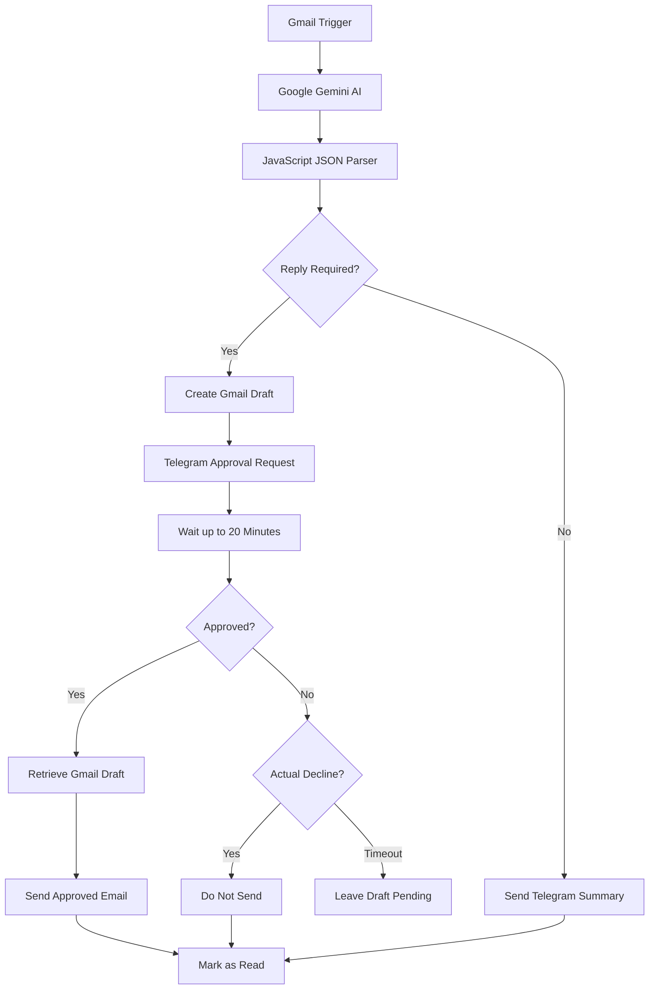

# 🤖 AI Email Assistant | n8n Automation

An AI-powered email management and automation system built using **n8n, Google Gemini, Gmail API, and Telegram**.

The system automatically monitors incoming emails, understands their content, generates concise summaries, identifies emails that require a response, and prepares professional email drafts.

It also integrates a Telegram-based human approval mechanism, allowing users to review and approve suggested replies before they are sent.

## ✨ Key Features

- **Automated Email Monitoring:** Detects incoming unread emails using Gmail Trigger.
- **AI Email Summarization:** Uses Google Gemini 3 Flash to generate concise email summaries.
- **Smart Reply Detection:** Determines whether an incoming email requires a response.
- **AI Reply Generation:** Generates polite and professional email replies.
- **Automatic Draft Creation:** Saves suggested replies directly in Gmail Drafts.
- **Telegram Notifications:** Delivers email summaries and suggested replies through Telegram.
- **Human-in-the-Loop Approval:** Provides Approve and Decline options through Telegram.
- **Time-Limited Approval:** Waits up to 20 minutes for an approval response.
- **Conditional Email Sending:** Sends the prepared Gmail draft only after approval.
- **Email Status Management:** Marks emails as read through the appropriate workflow paths.

## 🛠️ Tech Stack

| Technology | Purpose |
|---|---|
| n8n | Workflow automation |
| Google Gemini 3 Flash | AI email analysis and reply generation |
| Gmail API | Email retrieval, draft creation and sending |
| Telegram Bot API | Notifications and approval interaction |
| JavaScript | JSON parsing and data processing |
| JSON | Structured AI responses |

## 🔄 Workflow Architecture



## ⚙️ How It Works

### 1. Email Detection
Gmail Trigger monitors the inbox for incoming unread emails.

### 2. AI-Powered Analysis
Google Gemini 3 Flash analyzes the email and generates:
- A one-line summary.
- A reply-required decision.
- A suggested professional response.

### 3. Data Processing
A JavaScript Code node parses the AI-generated JSON and extracts individual fields for downstream workflow operations.

### 4. Conditional Routing

The workflow checks whether an email requires a response.

**If a reply is required:**
1. Gemini generates a suggested response.
2. Gmail creates a draft.
3. Telegram sends the summary and suggested reply.
4. The workflow waits up to 20 minutes for a decision.
5. If approved, the original Gmail draft is retrieved and sent.
6. If declined, the email is not sent.
7. If no response arrives within the time limit, the draft remains available in Gmail for later review.

**If no reply is required:**
1. A summary is sent directly to Telegram.
2. No reply draft is created.

## 📸 Workflow Preview

Add your n8n workflow screenshot here.

```markdown

```

## 🚀 Setup Instructions

### Prerequisites

- An n8n Cloud account or self-hosted n8n instance.
- A Google account with Gmail API access.
- Google Gemini API key.
- Telegram account.
- Telegram bot created using BotFather.

### Installation

1. Clone this repository:

   ```bash
   git clone https://github.com/YOUR-USERNAME/ai-email-assistant-n8n.git
   ```

2. Open your n8n instance.
3. Import the workflow JSON file.
4. Configure Gmail OAuth2 credentials.
5. Configure Google Gemini API credentials.
6. Connect your Telegram bot credentials.
7. Configure your Telegram Chat ID.
8. Test the workflow using sample emails.
9. Activate the workflow.

## 🔐 Security

- Never upload API keys, OAuth tokens or passwords.
- Configure credentials directly inside n8n.
- Remove personal email addresses and Telegram Chat IDs from exported workflow files.
- Review AI-generated responses before approving them.

## 🔮 Future Improvements

- Reliable duplicate email detection.
- Improved error handling and retry mechanisms.
- Email categorization and priority detection.
- Multiple email account support.
- Approval history and pending draft tracking.
- Improved monitoring and execution analytics.

## 🎯 Project Objective

The objective of this project is to demonstrate how Large Language Models, API integrations, and workflow automation can be combined to build a practical email management solution.

It explores AI-powered decision-making, structured data processing, conditional workflows, and human-in-the-loop automation.

---

**Built with ❤️ using n8n, Google Gemini, Gmail API, and Telegram.**
